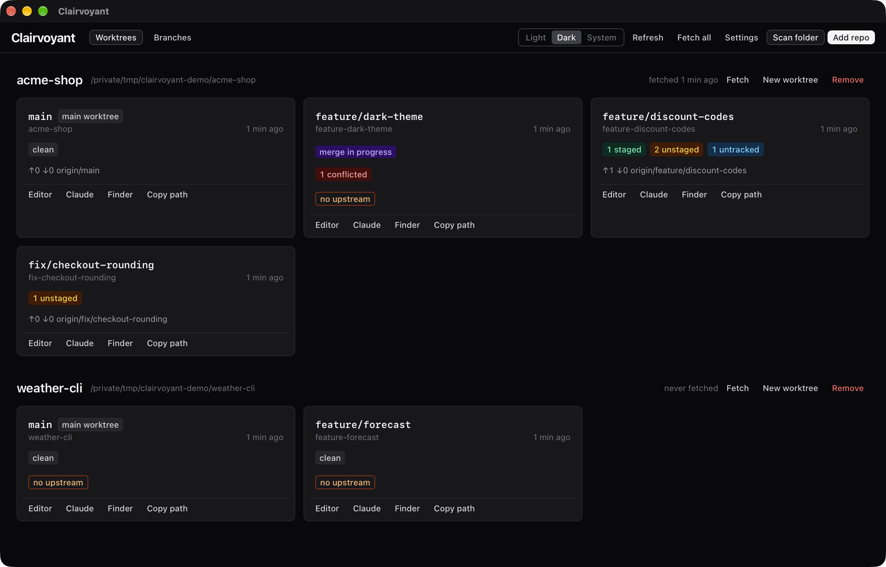
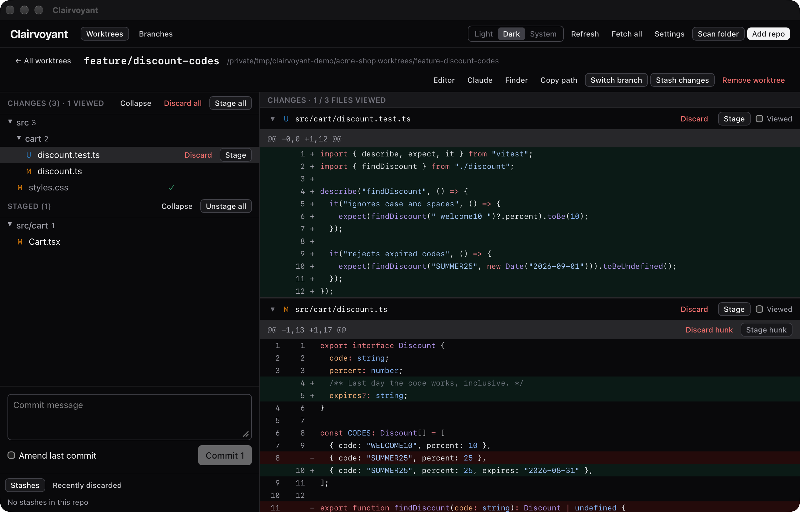
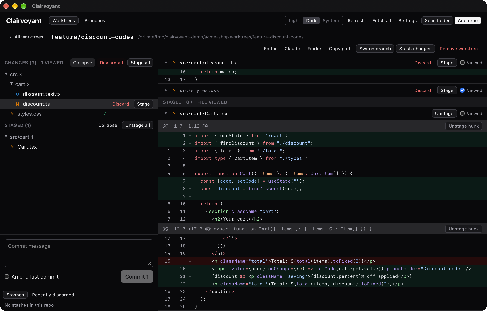
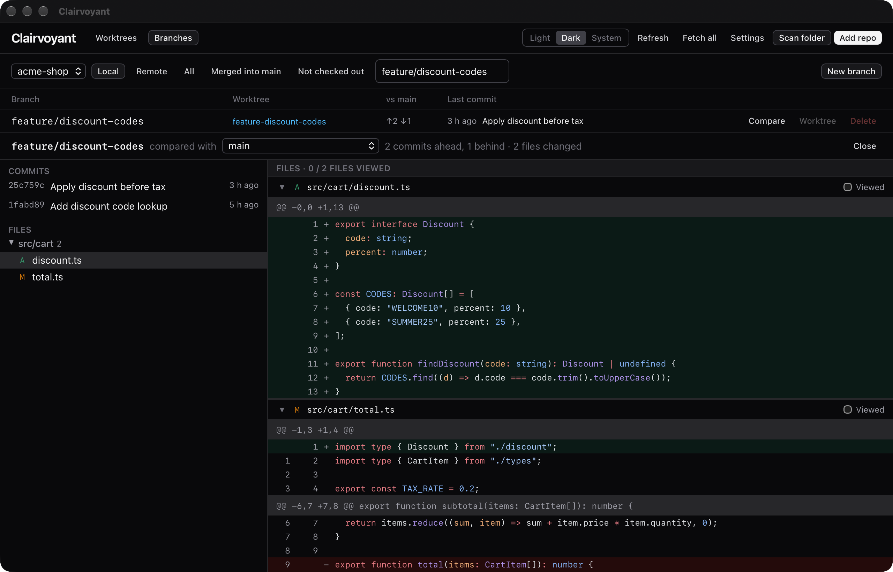

# Clairvoyant

One dashboard for every git worktree you're working in. See branches and
pending changes across all your repos and worktrees, review them file by file,
and manage them locally without pushing anything.

Built for working with coding agents that each run in their own worktree: you
can watch what every agent has changed, review it like a pull request, and
stage, discard or commit without opening a PR.

Clairvoyant is a companion to git, not a replacement: it runs the `git` CLI
under the hood, so your hooks, config and signing all behave as usual. It
never pushes or pulls; the only network call is a Fetch you click yourself.



## Features

- **Dashboard** of every worktree in your registered repos: branch, staged /
  unstaged / untracked / conflicted counts, ahead/behind, stashes, last
  activity, rebase or merge in progress, and warnings. Updates live as files
  change.
- **Review pane**: every changed file's diff in one scroll, with syntax
  colours. Click a file in the folder tree to jump to it, and tick **Viewed**
  as you go (a file un-ticks itself if it changes again).
- **Stage, unstage and discard** per file, per folder or per hunk. Discards
  can always be undone.
- **Commit** (and amend, unless already pushed) with live output from your git
  hooks. **Stash**, switch branches, create and remove worktrees.
- **Branches** view with merged / not-checked-out filters and a **Compare**
  view that shows what a pull request would contain.
- Light / Dark / System theme.

See [docs/DESIGN.md](docs/DESIGN.md) for the design decisions and roadmap.

## Screenshots

**Review a worktree.** Every changed file in one scroll, with a folder tree to
jump around, per-hunk stage/discard and the commit box.



**Viewed marks.** Tick files off as you review; they fold away and get a check
in the tree. Staged changes sit in their own group.



**Branches and Compare.** See how far a branch is from the default branch and
review what its pull request would contain, without opening one.



The screenshots use made-up demo repositories.

## Install

Clairvoyant runs on **macOS** (developed on Apple Silicon). There's no
download yet: you build the app yourself, which takes a few minutes the first
time.

### 1. Install the tools

You need Xcode's command line tools, Node.js and Rust.

```bash
xcode-select --install
```

- **Node.js** 20.19+ or 22.12+: download it from [nodejs.org](https://nodejs.org),
  or with Homebrew:

  ```bash
  brew install node
  ```

- **Rust** (stable, 1.85+): the official installer is the simplest:

  ```bash
  curl --proto '=https' --tlsv1.2 -sSf https://sh.rustup.rs | sh
  ```

  Then open a new terminal so `cargo` is on your `PATH`.

Check that everything is there:

```bash
git --version && node --version && cargo --version
```

### 2. Download and build

```bash
git clone https://github.com/Davidengstrom01/Clairvoyant.git
```

```bash
cd Clairvoyant && npm install && npm run tauri build
```

The build ends with a line like
`Finished 1 bundle at: …/src-tauri/target/release/bundle/macos/Clairvoyant.app`.

### 3. Copy it to Applications

```bash
cp -R src-tauri/target/release/bundle/macos/Clairvoyant.app /Applications/
```

Open **Clairvoyant** from Launchpad or Spotlight. Because you built it on
your own Mac, macOS opens it without a security warning even though it isn't
signed. To keep it handy, right-click its Dock icon → Options → Keep in Dock.

### 4. First run

1. Click **Add repo** and pick any folder inside a git repository, or
   **Scan folder** to find all repos under a folder (e.g. `~/code`) and add
   several at once. Every worktree of each repo shows up automatically.
2. Open **Settings** to set:
   - **Open in editor**: the command for the Editor button, e.g. `code {path}`
     (VS Code), `cursor {path}` or `open -a "Rider" {path}`.
   - **Open Claude Code**: the command for the Claude button. The default
     opens Ghostty in the worktree and runs `claude`; change it for your
     terminal, e.g. `open -a Terminal {path}`.
   - **Worktree folders**: where new worktrees of each repo are created.
3. Click a worktree card to review and manage its changes.

### Updating

```bash
cd Clairvoyant && git pull && npm install && npm run tauri build
```

Quit Clairvoyant (⌘Q), then copy the new build over the old one:

```bash
cp -R src-tauri/target/release/bundle/macos/Clairvoyant.app /Applications/
```

Your repos, settings, theme and Viewed marks are kept.

### Uninstall

Delete the app and its settings:

```bash
rm -rf /Applications/Clairvoyant.app ~/Library/Application\ Support/dev.clairvoyant.desktop
```

Theme and Viewed marks live in the app's web storage, under
`~/Library/WebKit/dev.clairvoyant.desktop` if that folder exists.

Clairvoyant also keeps undo copies of discarded files inside each repo, under
`refs/clairvoyant/trash`, and prunes them after 14 days. To remove them from a
repo right away, run this inside it:

```bash
git for-each-ref --format='%(refname)' refs/clairvoyant | xargs -n1 git update-ref -d
```

### Troubleshooting

- **`cargo: command not found`**: open a new terminal after installing Rust.
  If you installed `rustup` with Homebrew, add `/opt/homebrew/opt/rustup/bin`
  to your `PATH` (Homebrew doesn't link it).
- **Commit hooks can't find `node`/`npx`**: Clairvoyant uses your login
  shell's `PATH`, so make sure those tools are on the `PATH` set in
  `~/.zprofile` or `~/.zshrc`, then restart the app.
- **The Editor or Claude button does nothing**: check the command in
  **Settings**; the error from the command is shown in the corner.

## Development

```bash
npm install
npm run tauri dev      # run the app with hot reload
npm test               # frontend unit tests (Vitest)
npm run test:rust      # Rust unit + integration tests
npm run build          # typecheck + build the frontend
npm run tauri build    # build the .app bundle
```

The Rust tests create throwaway git repositories, so they need `git` but
nothing else.

To run the app on a separate list of repos (for demos or screenshots) without
touching your own, point `CLAIRVOYANT_CONFIG_DIR` at a folder holding a
`repos.json`:

```bash
open -n -a src-tauri/target/release/bundle/macos/Clairvoyant.app --env CLAIRVOYANT_CONFIG_DIR=/tmp/demo-config
```

## License

[MIT](LICENSE)
